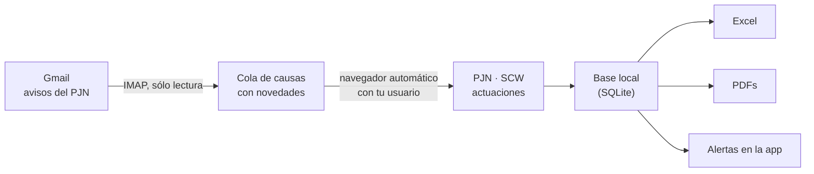

# PJN Novedades

**Lee las novedades de tus causas del Poder Judicial de la Nación y las junta en un Excel, para que no tengas que entrar al portal del PJN a revisarlas una por una.**

En **ejecuciones fiscales**, además, te avisa cuando sale un **primer auto** o una **sentencia**.

Funciona con los avisos por mail que ya te manda el PJN: no hay que cargar las causas a mano.

---

## ¿Qué hace?

- Lee de tu **Gmail** los avisos de novedades del PJN (`scw-noreply@pjn.gov.ar`).
- Entra al **PJN con tu usuario**, abre cada causa con novedades y lee las actuaciones nuevas.
- Guarda cada actuación nueva con los datos que muestra el portal del PJN (**fecha, tipo, descripción/detalle y fojas**) y baja su **PDF**.
- En ejecuciones fiscales te muestra **alertas**:
  - **Primeros autos** y **sentencias** que aparecieron **en el último barrido**.
  - **Primeros autos** y **sentencias del mes**, con un selector para ver meses anteriores.
- Arma un **Excel** con hojas de Alertas, Por mes, Actuaciones, Causas, Mails del PJN y Corridas.

Todo corre **en tu PC**. No hay servidores, nubes ni cuentas nuevas, y **no usa inteligencia artificial** (ver [Sin inteligencia artificial](#sin-inteligencia-artificial)).

## ¿Cómo lo hace?



1. **Mails**: entra a tu Gmail con una *contraseña de aplicación* (ver abajo) y busca los avisos del PJN de los últimos días. Sólo **lee**: no borra, no mueve y no marca nada como leído.
2. **Cola**: junta los avisos por causa. Si una causa tuvo tres avisos, se revisa una sola vez.
3. **PJN**: con un navegador invisible entra al sistema de consulta de causas (SCW) con tu usuario, abre cada causa desde el link del mail y lee la tabla de actuaciones. Si hace falta, pasa de página hasta llegar a lo que ya tenía registrado.
4. **Registro**: guarda sólo las actuaciones **nuevas** y **con documento**. Las que no traen archivo, como "A DESPACHO" o "EXPEDIENTE EN LETRA", son ruido procesal y se descartan. Nunca duplica: si corrés dos veces, la segunda no agrega nada.
5. **Alertas**: clasifica cada actuación nueva (ver [Alertas](#alertas)).
6. **Excel**: lo regenera completo al final.

Si una causa falla (el PJN no respondió, por ejemplo), sus avisos quedan pendientes y se reintentan en el próximo barrido.

## Sin inteligencia artificial

- La app es **Python y HTML puro**. No usa ChatGPT, Claude, Gemini ni ningún otro modelo de lenguaje (LLM): ni para leer los mails, ni para revisar las causas, ni para decidir qué es un primer auto o una sentencia.
- Las alertas salen de **reglas fijas**: patrones de texto sobre el tipo y el detalle de cada actuación, escritos en [`clasificador.py`](clasificador.py). La misma actuación da siempre el mismo resultado.
- La app se conecta **sólo a dos lugares**:
  - **Gmail**, para leer los avisos del PJN de tu propia cuenta.
  - **El portal del PJN**, donde entra con tu usuario y consulta tus causas, igual que si lo hicieras vos a mano.

  No manda tus datos a ningún otro lado: no hay servidores propios, estadísticas de uso ni terceros.
- Si usás un asistente de IA para [instalarla](#instalación-con-ayuda-de-un-asistente-de-ia), interviene sólo en la instalación: la app funciona sin él. Lo que escribas en ese chat sí lo ve el asistente; por eso las claves se cargan en el formulario de la app y nunca en el chat.

## Qué necesitás

- Una PC con **Windows 10 u 11**. En Mac o Linux debería andar, pero **no está probado**; ver [Instalación en Mac o Linux](#instalación-en-mac-o-linux).
- Una cuenta de **Gmail** donde te lleguen los avisos del PJN, con la **verificación en 2 pasos** activada.
- Tu **usuario y clave del PJN**.
- Internet desde una conexión **de Argentina**: casa u oficina. El PJN bloquea conexiones desde servidores en la nube.

## Instalación (Windows)

1. **Descargá** esta carpeta (botón verde *Code* → *Download ZIP* en GitHub) y descomprimila donde quieras, por ejemplo en `Documentos`.
2. Doble click en **`instalar.bat`**. Instala Python si no lo tenés, las librerías y el navegador que usa la app. Tarda unos minutos y se hace **una sola vez**. Al final te ofrece crear un acceso directo en el Escritorio.
3. Doble click en **`iniciar.bat`** (o en el acceso directo). Se abre la app en tu navegador, en `http://127.0.0.1:8770`.

> **¿Te trabás?** Usá un asistente de IA (Claude Code, Codex o Gemini CLI) para que te guíe. Ver [Instalación con ayuda de un asistente de IA](#instalación-con-ayuda-de-un-asistente-de-ia).

## Primer uso: la configuración

La primera vez, la app muestra un formulario. **No hay que editar ningún archivo**: el formulario guarda todo en un archivo `.env` dentro de la carpeta de la app.

### 1 · Gmail y la contraseña de aplicación

La app no usa tu clave de Gmail. Usa una **contraseña de aplicación**: una clave aparte, de 16 letras, que sirve sólo para leer el correo y que podés revocar cuando quieras.

1. Activá la **verificación en 2 pasos** de tu cuenta de Google, si no la tenés: [myaccount.google.com/signinoptions/two-step-verification](https://myaccount.google.com/signinoptions/two-step-verification).
2. Entrá a [myaccount.google.com/apppasswords](https://myaccount.google.com/apppasswords).
3. En "Nombre de la app" escribí **PJN Novedades** y tocá **Crear**.
4. Copiá las 16 letras y pegalas en el formulario.
5. Tocá **Probar conexión con Gmail**: te dice cuántos avisos del PJN encontró en los últimos 30 días.

### 2 · Usuario del PJN

Tu CUIT/CUIL. Queda guardado: cada vez que abras la app vas a ver tu usuario ya cargado y sólo vas a tener que escribir la clave.

**La clave del PJN no se guarda nunca**: la app te la pide cada vez que la abrís y la olvida al cerrarla.

### 3 · Opciones

| Opción | Para qué sirve | Valor inicial |
|---|---|---|
| Carpeta de datos | Dónde quedan el Excel, los PDFs y la base | `datos`, dentro de la carpeta de la app |
| Días hacia atrás | Cuántos días de mails leer en cada barrido | 7 |
| Filtro de carátula | Revisar sólo causas cuya carátula contenga ciertas palabras, por ejemplo `EJECUCION FISCAL` | vacío = todas |
| Descargar PDFs | Bajar el documento de cada actuación nueva | sí |

Podés cambiar todo después con el botón **⚙**.

## Uso diario

1. Abrí la app (`iniciar.bat`) e ingresá tu clave del PJN.
2. Tocá **▶ Buscar novedades**.
3. Mirá el avance en vivo. **■ STOP** termina la causa en curso y frena; lo que falta queda para la próxima vez.
4. Revisá las **alertas** y abrí el **Excel** con el botón 📊.

La ventana negra que se abre junto con la app **es** la app: si la cerrás, se cierra.

Una vez por día o por semana alcanza. Si no la abrís por más de 7 días, subí "Días hacia atrás" para no perder avisos.

## Alertas

### Primer auto

Es el despacho que tiene por presentada la demanda y ordena el mandamiento de intimación de pago. Cada secretaría lo rotula distinto: "PRIMER AUTO", "1ER AUTO ANTICIPATORIO FISCO", "INICIO FISCO SIN BONO", "PRIMER PROVEIDO ARCA", "\*AUTO\* - DIGITALES - ARCA - INICIAL EJECUCION"…

- Se busca sólo en **ejecuciones fiscales o tributarias** y en actuaciones del tipo *FIRMA DESPACHO*.
- **No** cuentan los previos ("PRIMER AUTO - PREVIO ACLARE TIPO SOCIETARIO") ni los que lo citan, lo anulan o lo revocan ("ESTESE AL AUTO ANTICIPATORIO", "DEJESE SIN EFECTO EL PRIMER AUTO").

### Sentencia

Es el despacho del juzgado que la dicta. En ejecución fiscal casi nunca dice SENTENCIA: se dicta **declarando expedita la vía** (art. 92, ley 11.683), con rótulos como "EXPEDITA", "SENTENCIA EXPEDITA - S17" o "5 SEC - EXPEDITA ARCA". En la Seguridad Social se rotula "STR" o "SEI".

- **No** cuentan el llamamiento de autos ("AUTOS PARA SENTENCIA"), los pedidos de la parte ("SOLICITA SE DICTE SENTENCIA"), las notificaciones, los despachos previos ("PREVIO A DICTAR SENTENCIA…") ni lo que resuelve la Cámara o la Corte.

Las reglas salen de un relevamiento de cientos de miles de actuaciones reales de ejecuciones fiscales de CAF y CSS (2023-2026). Están en [`clasificador.py`](clasificador.py) y se prueban contra más de 200 rótulos reales en [`tests/`](tests).

### "Último barrido" y "Por mes"

- **Último barrido**: lo que apareció en la última búsqueda.
- **Por mes**: todo lo del mes elegido, según la **fecha de la actuación**, sin importar cuándo lo encontró la app.

La primera vez que la app ve una causa, registra su primera página de actuaciones (las 15 más recientes). Las que son bastante anteriores al aviso del mail se toman como **historia de la causa**: quedan en el Excel y cuentan en su mes, pero no aparecen como alerta del barrido.

## Tus datos

Todo queda en la **carpeta de datos**:

```
datos/
├── Novedades PJN.xlsx      el Excel (se regenera en cada barrido)
├── PDFs/
│   └── CAF 99001-2026/
│       └── 2026-10-28 FIRMA DESPACHO - SENTENCIA EXPEDITA - S17.pdf
└── pjn_novedades.db        la base (no la borres: es la memoria de la app)
```

- **No escribas en el Excel**: se reemplaza en cada barrido. Para anotar, copiá la hoja a otro archivo.
- Si el Excel está abierto durante un barrido, Windows no deja actualizarlo. No se pierde nada: cerralo y tocá **Buscar novedades** de nuevo.
- **¿Google Sheets?** Elegí como carpeta de datos una carpeta de **Google Drive para escritorio** o de **OneDrive**: el Excel y los PDFs quedan en la nube, y Google Sheets abre el Excel directo.

## Seguridad y privacidad

- **Tu usuario del PJN** (CUIT/CUIL) queda guardado en el archivo `.env`, así aparece ya cargado cada vez que entrás.
- **La clave del PJN no se guarda en ningún lado.** La escribís cada vez que abrís la app y se olvida al cerrarla.
- **La contraseña de aplicación de Gmail** se guarda en el archivo `.env` de la carpeta de la app, en tu PC. Sirve sólo para leer el correo. Si alguna vez se compromete, revocala en [myaccount.google.com/apppasswords](https://myaccount.google.com/apppasswords).
- La app **sólo lee** tu Gmail: busca los mails de `scw-noreply@pjn.gov.ar`. No manda mails, no borra y no marca nada como leído.
- La app escucha sólo en `127.0.0.1`: **no es accesible desde otra computadora** de la red.
- El repositorio **nunca** incluye `.env`, la base, el Excel ni los PDFs. El [`.gitignore`](.gitignore) los bloquea. Si compartís la carpeta con alguien, **no** le pases `.env` ni `datos/`.

## Problemas frecuentes

| Problema | Qué hacer |
|---|---|
| "Gmail rechazó el acceso" | Tiene que ser una **contraseña de aplicación** (16 letras), no tu clave de Gmail. La verificación en 2 pasos tiene que estar activada. |
| "Encontré 0 mails del PJN" | Revisá que los avisos lleguen a **esa** cuenta. Si se reenvían desde otra, configurá la otra. Probá con más días. |
| "Usuario o contraseña del PJN incorrectos" | Probá entrar a mano en [portalpjn.pjn.gov.ar](https://portalpjn.pjn.gov.ar). |
| El PJN no responde o da timeout | El PJN bloquea conexiones desde la nube y a veces está lento. Corré la app desde tu casa u oficina y reintentá más tarde: lo pendiente se retoma solo. |
| "Falta instalar el navegador del scraper" | Corré `instalar.bat` de nuevo. |
| "Mail sin link a la causa" | Ese aviso no traía el link al SCW. Abrí la causa a mano desde el PJN. |
| Tope de 5 páginas en una causa | Entre dos barridos se juntaron más de 75 actuaciones. Revisá la causa a mano por si falta algo más viejo. |

## Instalación con ayuda de un asistente de IA

Sirve cualquiera de estos:

- [Claude Code](https://claude.com/claude-code), de Anthropic.
- [Codex](https://developers.openai.com/codex), de OpenAI. *No probado.*
- [Gemini CLI](https://github.com/google-gemini/gemini-cli), de Google. *No probado.*

Abrilo en la carpeta descomprimida de la app y pegale este mensaje:

```text
Hola. Quiero instalar y configurar la app "PJN Novedades" que está en esta carpeta.
No soy programador/a: soy abogado/a. Guiame paso a paso, de a un paso por vez, en
castellano simple, y ejecutá vos los comandos que haga falta.

Antes de empezar leé AGENTS.md y README.md.

Reglas:
- Nunca me pidas que te escriba contraseñas en el chat (ni la de aplicación de Gmail
  ni la del PJN). Las cargo yo en el formulario de la app, que genera el archivo .env.
- No edites el .env a mano ni lo subas a ningún lado.

Objetivo: dejar la app abierta en el navegador, con la configuración guardada y la
conexión con Gmail probada.
```

El archivo [`AGENTS.md`](AGENTS.md) le da al asistente el paso a paso, los problemas típicos y estas mismas reglas, aunque no pegues el mensaje. Codex lo lee directo; Claude Code y Gemini CLI, a través de `CLAUDE.md` y `GEMINI.md`.

## Instalación en Mac o Linux

> **No probado.** La app está pensada y probada en Windows.

```bash
python3 -m pip install -r requirements.txt
```

```bash
python3 -m playwright install chromium
```

```bash
python3 app.py
```

Se necesita Python 3.10 o más nuevo.

## Para desarrolladores

```
app.py            servidor local (127.0.0.1:8770): configuración, login, panel, alertas
web/app.html      la interfaz (un solo archivo, sin dependencias)
scraper.py        un barrido: Gmail → cola → PJN → base → Excel
gmail_pjn.py      IMAP con contraseña de aplicación; parseo de los avisos del PJN
pjn.py            motor del SCW con Playwright: login, actuaciones, paginación, descargas
clasificador.py   reglas de primer auto y sentencia
almacen.py        base SQLite: mails, causas, actuaciones, corridas, alertas
excel.py          exportación a Excel
config.py         lectura y escritura del .env (la usa el formulario)
tests/            tests sin red ni login (uno abre un Chromium local)
```

Tests, desde la carpeta de la app:

```bash
python -m unittest discover -s tests
```

Detalles de diseño:

- **Dedup**: cada actuación tiene una clave md5 de (expediente, fecha, tipo, detalle, fojas). Re-correr no duplica.
- **Paginación**: si la causa ya tiene actuaciones registradas, avanza páginas (15 filas cada una) hasta una sin nada nuevo, con tope de 5. Nunca registra actuaciones anteriores a la más vieja ya registrada, así no vuelca el histórico de causas viejas.
- **STOP**: la app crea el archivo `.detener` y `scraper.py` lo mira entre causas, así ninguna queda a medias.
- **Sin la app**: `PJN_PASSWORD=... python scraper.py` hace un barrido por consola, con la configuración del `.env`.

## Licencia

[MIT](LICENSE): podés usarlo, modificarlo y compartirlo, incluso con fines comerciales, siempre que conserves el aviso de copyright y la licencia. Se entrega sin garantía de ningún tipo.
